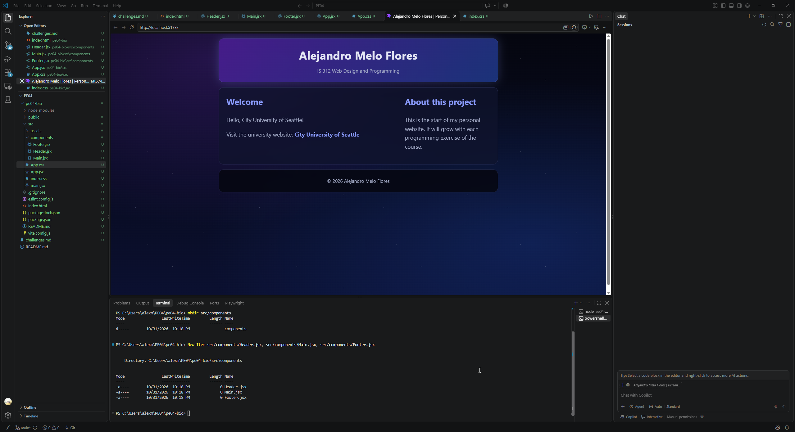

# IS 312: Web Design and Programming

## PE04: Migrating Your Bio Page to React and JSX

**Student:** Alejandro Melo Flores

**Repository:** https://github.com/Al3mf/PE04

---

## Screenshot of the final working example

---

## Step 1: Initialize the React application with Vite

I created a new public repository called PE04 and cloned it to my computer. Inside it, I created the React app with `npm create vite@latest pe04-bio -- --template react`. I chose ESLint as the linter. Then I moved into the project folder, installed the packages with `npm install` and started the development server with `npm run dev` to confirm that the starter page worked.

---

## Step 2: Translate the static HTML into JSX components

I moved the `<title>` and the author `<meta>` tag from my PE01 page into the `index.html` of the React app, because React only controls what goes inside the `root` div. Then I split my page into three components inside a `src/components` folder: `Header`, `Main` and `Footer`. Each one is a function that returns JSX and is exported with `export default`. In `App.jsx` I imported the three components and placed them inside a fragment (`<>`), so no extra `div` is added to the page.

While translating the HTML, I changed every `class` attribute to `className`, because `class` is a reserved word in JavaScript. I used `{' '}` to keep the space before my link, because JSX removes spaces at the end of a line. I also made the footer dynamic: the year is calculated with `new Date().getFullYear()` and shown with the JavaScript expression `{year}`.

---

## Step 3: Isolate the styles in App.css

I emptied `index.css` to remove the global styles of the Vite template, which were changing the layout of my page. Then I moved my styles into `App.css`, which is imported in `App.jsx`. I did not need to change my selectors, because `className` in JSX becomes the normal `class` attribute in the final HTML.

I updated the design to a space theme that matches my personal website. All colors are stored in CSS variables, the background has purple and blue nebula gradients, and a star field made only with CSS twinkles behind the content. The cards have a semi transparent background with a blur effect. I also added a `prefers-reduced-motion` rule, so the stars stop moving for users who prefer less motion. The layout keeps two columns on large screens and changes to one column under 720px.

---

## Step 4: Exclude node_modules from the repository

The Vite template includes a `.gitignore` file that already lists `node_modules`. I confirmed it with `git status`, which did not show the folder, and with `git check-ignore -v pe04-bio/node_modules`, which showed the `.gitignore` rule. Then I committed and pushed the project to GitHub. The `node_modules` folder is very large and can always be recreated with `npm install` from the `package.json` file, so it should never be uploaded.

---

## Challenges

- I was confused about adding the p { component to the .css file
- Does an empty file affects negativitely a web app?

---

## AI Usage

I used Claude (AI assistant) to guide me through the steps of the assignment, convert my PE01 HTML into JSX components and create the space theme for my CSS. I tested each step in the browser to understand the changes.
